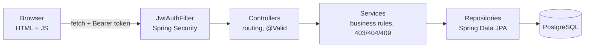

# Bookapi — Book Marketplace

[](https://github.com/DaQ-Ng/Bookapi/actions/workflows/ci.yml)

A full-stack used-book marketplace: users register, log in, list books for sale, and buy other users' books. The backend is a Spring Boot REST API secured with JWT, backed by PostgreSQL, and served together with a small JavaScript frontend.

**Live demo:** https://bookapi-xtof.onrender.com
*(free hosting: the first visit after ~15 minutes idle takes about a minute to wake up)*

## Highlights

- **JWT authentication** with Spring Security: passwords hashed with BCrypt, stateless token checked on every request.
- **Ownership rules**: only a book's seller can edit or delete it (`403`), and sellers can't buy their own books.
- **Safe concurrent purchases**: optimistic locking (`@Version`) guarantees that when two buyers click "Buy" on the same copy at the same moment, exactly one order succeeds and the other gets `409 Conflict`.
- **Validation and consistent errors**: invalid input returns `400` with a field → message map; missing data `404`; a global exception handler keeps every error readable.
- **Search and pagination** over available books.
- **27 automated tests** (JUnit 5, Mockito, MockMvc) run by GitHub Actions on every push.
- **Dockerized** (multi-stage build) and deployed on Render with a Neon PostgreSQL database.

## Architecture



| Layer | Classes | Job |
|---|---|---|
| Frontend | `static/index.html`, `app.js` | One page served by Spring Boot; every call goes through one `api()` helper that adds the token |
| Security | `SecurityConfig`, `JwtAuthFilter`, `JwtService` | Public vs. protected routes, reads and verifies the JWT, `401` when missing or invalid |
| Controllers | `BookController`, `OrderController`, `AuthController` | HTTP routing; take the logged-in user from the token (`Principal`), never from the request body |
| Services | `BookService`, `OrderService`, `UserService` | Business rules: ownership checks, availability, price copied into the order |
| Data | `Book`, `User`, `Order` entities + repositories | `@ManyToOne` relations (book → seller, order → buyer and book) |

Code is organized by feature: `auth/`, `book/`, `order/`, `user/`, `review/`, `common/`.

## API

| Method | Path | Auth | Description | Errors |
|---|---|---|---|---|
| POST | `/auth/register` | — | Create an account (password stored as a BCrypt hash) | 400 |
| POST | `/auth/login` | — | Returns `{"token": "..."}` | 401 |
| GET | `/auth/me` | token | The logged-in user's `id` and `name` | 401 |
| GET | `/books?title=&page=&size=` | — | Search available books, paginated | |
| GET | `/books/{id}` | — | One book | 404 |
| POST | `/books` | token | List a book; seller = you | 400, 401 |
| PUT | `/books/{id}` | token | Edit your book | 400, 401, 403, 404 |
| DELETE | `/books/{id}` | token | Remove your book | 401, 403, 404 |
| POST | `/orders` | token | Buy a book: `{"bookId": 4}` | 401, 403 own book, 404, 409 sold |
| GET | `/orders` | token | Your orders, newest first | 401 |

Emails and passwords never appear in responses.

## Run it locally

### With Docker (easiest)

Needs Docker. Starts the app and its own PostgreSQL:

```bash
export DB_PASSWORD=any_local_password
export JWT_SECRET=$(openssl rand -base64 32)
docker compose up --build
```

Open http://localhost:8080.

### Without Docker

Needs Java 21 and a local PostgreSQL with a `bookdb` database owned by `bookuser`:

```bash
export DB_PASSWORD=your_db_password
export JWT_SECRET=$(openssl rand -base64 32)
./mvnw spring-boot:run
```

### Configuration

All settings come from environment variables, with local defaults:

| Variable | Default | Purpose |
|---|---|---|
| `DB_URL` | `jdbc:postgresql://localhost:5432/bookdb` | Database address |
| `DB_USERNAME` | `bookuser` | Database user |
| `DB_PASSWORD` | — (required) | Database password |
| `JWT_SECRET` | — (required) | Base64 key that signs login tokens |
| `PORT` | `8080` | HTTP port (set by Render) |
| `SHOW_SQL` | `true` | Log generated SQL |

## Tests

```bash
./mvnw test
```

| Test class | Type | Covers |
|---|---|---|
| `BookServiceTest` | Unit (Mockito) | Ownership 403s, 404s, seller taken from the token, client id ignored on create |
| `OrderServiceTest` | Unit (Mockito) | Buyer from token, can't buy own book, my-orders query |
| `UserServiceTest` | Unit (Mockito) | Look up the logged-in user, 401 when missing |
| `BookControllerTest`, `OrderControllerTest` | `@WebMvcTest` | HTTP layer without a database: 400 validation, 404, 409 lost race, 200 `[]` |
| `BookTest` | Plain JUnit | Entity constructor |
| `BookapiApplicationTests` | `@SpringBootTest` | Whole app starts (needs PostgreSQL; CI provides one) |

## Deployment

- **CI:** `.github/workflows/ci.yml` starts a throwaway PostgreSQL and runs all tests on every push.
- **App:** Render builds the `Dockerfile` (JDK build stage → small JRE runtime image) on every push to `main`.
- **Database:** Neon serverless PostgreSQL; connection details are Render environment variables, never in the repo.

## Tech stack

Java 21 · Spring Boot 4.1 (Web MVC, Security, Data JPA, Validation) · Hibernate 7 · PostgreSQL · JJWT · JUnit 5 · Mockito · Docker · GitHub Actions · Render · Neon · HTML/CSS/JavaScript
